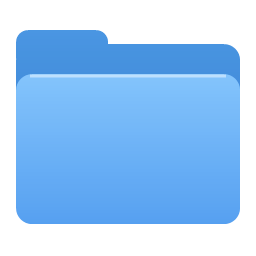
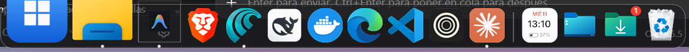
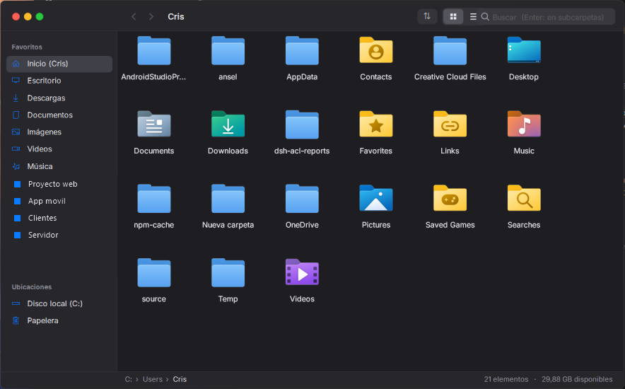
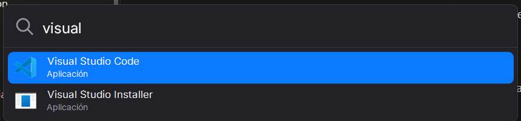
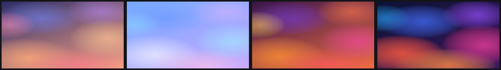

<div align="center">

# MacDock
 
**Convierte tu Windows 10/11 en algo que se ve y se siente como macOS, sin instalar programas pesados.**
 
Dock con lupa · Vista previa de ventanas · Animaciones de apertura, Genie y cierre · Barra superior que se oculta · Finder · Spotlight · Quick Look · Más batería
 
~**25 MB de RAM privada** en reposo · CPU casi nula en reposo · Sin administrador · 100 % reversible
 
[**⬇️ Descargar el instalador**](Releases/MacDock-Instalador.zip) · [¿Qué hace?](#qué-incluye) · [Novedades](#novedades) · [Instalar](#instalación) · [Desinstalar](#desinstalar) · [Preguntas](#preguntas-frecuentes)
 

</div>
---
 
## ¿Qué es?
 
MacDock es **un solo programa pequeño** hecho en C# con el compilador que **ya trae Windows** (.NET Framework). No usa Electron, ni Rainmeter, ni programas de terceros, y no inyecta código en otras apps.
 
Incluye además un **menú de ajustes** (un script de PowerShell) que cambia la configuración de Windows para que se vea como un Mac y para que **la batería dure más**. Todo lo que cambia se guarda en un respaldo y se puede deshacer.
 
Este proyecto parte del trabajo original de [Cristhianmcc/macdock](https://github.com/Cristhianmcc/macdock) (licencia MIT) y lo extiende con las novedades que se listan abajo.
 
> ⚠️ **Proyecto independiente.** No está afiliado ni respaldado por Apple. No usa imágenes, fuentes ni iconos de Apple: todo (iconos, cursor, fondos) está dibujado por código o es software libre.
 
---
 
## Novedades
 
### 👁️ Vista previa al pasar el ratón
- Al dejar el ratón sobre el icono de una **app en ejecución** (~0,4 s) aparece una tarjeta con la **miniatura de sus ventanas** (hasta cuatro) y su título. Funciona también con la **lupa activa**.
- Usa las miniaturas de **DWM** de Windows: solo las muestra, **no modifica ni captura a la fuerza** las ventanas de otras apps.
- **No roba el foco**, se cierra al salir el ratón, al usar Alt+Tab y al abrir menús, y puedes pasar del icono a la tarjeta sin que se cierre.
- Clic en una miniatura para activar esa ventana; el menú contextual del icono también permite elegir una ventana por su título.
- Activada por defecto. Se apaga desde el menú o con `VistaPrevia=0` en `config.ini`; apagada, no existe ni su ventana ni su temporizador.
### ✨ Animaciones de ventana (opcional)
Desde el menú **Animaciones de ventanas** del dock (interruptor general, apagado por defecto):
 
| Animación | Qué hace |
|---|---|
| **Apertura** | La ventana crece desde el icono de su app al abrirse. |
| **Minimización — Genie** | Al minimizar, la ventana se «succiona» hacia su icono del dock. |
| **Cierre** | Al cerrar, la ventana se reduce y se desvanece. |
 
- **Velocidad del Genie:** Normal (0,5 s), Rápida (0,35 s) o Muy rápida (0,25 s), con `AnimGenieVel=0/1/2` en `config.ini`. Si no se configura, se mantiene la duración original (290 ms).
- Cada animación se activa por separado (`AnimAbrirScale`, `AnimMinGenie`, `AnimCerrarScale`).
- Son capas dibujadas por MacDock sobre la pantalla: **no modifican las ventanas** ni dependen de las animaciones de Windows.
- **Coste:** con ellas apagadas no existe hilo de captura ni temporizadores. Encendidas, MacDock refresca una imagen de la ventana activa para poder animarla: en nuestras mediciones, unos **+0,7 s de CPU por minuto** (~1 % de un núcleo) y **+4 MiB** de memoria privada.
### 🔝 Ocultar la barra superior
- La opción **«Ocultar barra superior automáticamente»** (menú del dock, `MenuBarAutoHide=1`) esconde la barra con una animación deslizante.
- **Reaparece** al llevar el ratón al borde superior de la pantalla y se vuelve a esconder al alejarlo.
- Se mantiene fuera de las apps en pantalla completa. Desactivada por defecto.
### 🛡️ Estabilidad
- **Recuperación segura** tras cierres inesperados (`taskbar.marker`, `gamma.marker`, `CriticalRestore`).
- 20 ciclos de pruebas de lupa, vista previa y animaciones sin crecimiento de objetos GDI/USER ni de handles.
- El registro de diagnóstico (`Diagnostico=1`) viene apagado, incluido el de Suspender.
---
 
## Qué incluye
 
### 🧲 Dock estilo Mac
- Tus apps con sus **iconos reales**, **efecto lupa** al pasar el mouse y un **puntito** bajo las que están abiertas.
- **Rebote** al abrir una app. Clic para abrir, traer al frente o minimizar. Arrastra para reordenar.
- **Arrastra una app al dock** para fijarla, o fíjala en la barra de Windows: aparece sola.
- **Suelta archivos en el dock:** en la Papelera se borran (se pueden recuperar), en una app se abren con ella y en Descargas o Escritorio se mueven ahí.
- Se **esconde solo** cuando una ventana lo tapa: lleva el mouse al borde de abajo y aparece deslizándose.
- La barra de tareas de Windows se oculta (vuelve sola si cierras el dock).
### 📚 Pilas (Stacks)
- **Escritorio** y **Descargas** como pilas: un panel con tus archivos agrupados (Hoy, Ayer, Esta semana…), con **miniaturas** y **buscador**.
- **Entra en las carpetas** sin salir de la pila, **arrastra archivos** a cualquier app y usa **Espacio** para la vista rápida.
- **Aviso de descargas:** el icono rebota y muestra un numerito con lo nuevo.
### 🔝 Barra superior
 

- Menú del sistema (Inicio, Configuración, Suspender, Reiniciar, Apagar, Bloquear).
- Nombre de la **app activa** (minimizar, maximizar, cerrar).
- **⌃ iconos de la bandeja** (antivirus, VPN, Drive…), **luna/sol** para modo oscuro/claro, Wi-Fi, volumen, batería y fecha/hora.
- **Centro de Control**: brillo, volumen, Wi-Fi, Bluetooth, No molestar, Compartir cercano y multimedia con carátula.
- **Flyout de la bandeja (^)** sin que aparezca la barra de Windows; se restaura el ocultamiento al cerrar.
### 🗂️ Finder
 

- Explorador de archivos propio: barra lateral con favoritos, vista de **iconos con miniaturas** o de **lista**, **ordenar** por nombre/fecha/tipo/tamaño y buscador.
- Copiar, cortar, pegar, renombrar, papelera, arrastrar y soltar, **Quick Look** y «Abrir terminal aquí».
- Se actualiza solo cuando cambia la carpeta. Solo usa memoria mientras está abierto.
### 🔍 Spotlight (Alt + Espacio)
 

- Busca **apps**, **archivos y carpetas** (usa el índice que Windows ya tiene), **ajustes** de Windows y hace **cálculos** (`25*4` → `100`).
### 👀 Quick Look (Espacio)
- Selecciona un archivo y presiona **Espacio**: vista previa grande de fotos, texto y código, y PDF/Word/Excel con los visores de Windows. Funciona en el Finder, en las pilas **y en el Explorador de Windows**.
### 🔴🟡🟢 Botones de ventana estilo Mac
- Los botones de cerrar, minimizar y maximizar se muestran como los de Mac en **todas las ventanas**: a color en la ventana activa y en gris en las demás.
- Es una capa encima de los botones de Windows: **no modifica las apps**.
### 🎨 Apariencia
- Acento azul, **cursor estilo Mac**, fuente **Inter** (libre), letras suavizadas y sin sonidos del sistema.
- **Fondos aurora** que cambian con la hora del día, también en la pantalla de bloqueo.
- **Carpetas azules**, Explorador con iconos grandes, menú Inicio más limpio y escritorio limpio.
- **Esquinas activas:** lleva el mouse a una esquina para ver todas las ventanas o el escritorio.
- **Clic derecho en el escritorio** con estilo Mac, con todas las opciones de Windows.

### 🔋 Batería y rendimiento
 
| Ajuste | Qué hace |
|---|---|
| Pantalla a 60 Hz con batería | Automático: máxima frecuencia enchufado y 60 Hz con batería. |
| Sin Turbo con batería | Menos calor y bastante más autonomía. |
| App Nap | Las apps que no usas pasan a modo eficiencia (nunca las que suenan). |
| Pantalla y suspensión | Con batería: atenúa al minuto, apaga a los 3 y duerme a los 15. |
| Hibernar al cerrar la tapa | Con batería, no gasta nada mientras está cerrada. |
| Ahorro de energía al 40 % | Se activa antes (Windows trae 20–30 %). |
| Apps en segundo plano, Game Bar | Dejan de correr y de grabar escondidas. |
| Apagar Docker/WSL | Un clic en el dock libera la RAM y la batería de su máquina virtual. |
 
---
 
## Consumo
 
Mediciones en un equipo con Windows 11, 60 s en reposo, mediana de 3 repeticiones:
 
| Configuración | CPU (por minuto) | Memoria privada |
|---|---|---|
| Animaciones apagadas | ~0,14 s (~0,2 % de un núcleo) | ~32 MB |
| Animaciones encendidas | ~0,83 s (~1,4 % de un núcleo) | ~36 MB |
 
- Finder y Quick Look usan memoria solo mientras están abiertos. Los ajustes de Windows no consumen nada (son configuración).
- El mínimo de .NET Framework 4 + WinForms con un formulario vacío ronda los 21 MB, por lo que la cifra de MacDock parte de ese suelo y no es comparable con la de una app nativa.
- Los valores varían según el equipo y lo que esté haciendo Windows en segundo plano.
---
 
## Instalación
 
1. [**Descarga el zip**](Releases/MacDock-Instalador.zip) y descomprímelo. Si no está, ejecuta `build.ps1`.
2. Doble clic en **`Instalar MacDock.exe`** y acepta.
   - Si aparece **«Windows protegió su PC»** o Defender lo bloquea, es porque el programa no tiene firma digital comercial y usa funciones que los antivirus miran con desconfianza (ocultar la barra de tareas, gestionar ventanas). Puedes enviar el archivo a Microsoft como falso positivo y revisar el código aquí.
3. Al terminar te pregunta si quieres abrir los **Ajustes de Windows**:
   - **`A`**: batería y velocidad recomendadas.
   - **`M`**: todo el aspecto Mac.
   - O elige por número solo lo que quieras.
4. Listo. El dock arranca solo cada vez que enciendes la PC.
**Requisitos:** Windows 10 u 11 de 64 bits. Nada más: .NET Framework 4 ya viene con Windows.
 
---
 
## Desinstalar
 
Cualquiera de estas opciones deja **Windows exactamente como estaba**:
 
- Doble clic en **`Desinstalar MacDock.exe`**.
- Menú Inicio → **Desinstalar MacDock**.
- Configuración → Aplicaciones → Aplicaciones instaladas → **MacDock** → Desinstalar.
¿Solo quieres deshacer los ajustes? Abre «Ajustes de Windows (batería y más)» y escribe **`R`**.
 
---
 
## Atajos
 
| Atajo | Acción |
|---|---|
| **Alt + Espacio** | Spotlight |
| **Espacio** | Quick Look del archivo seleccionado |
| **Win + V** | Historial del portapapeles (se activa en los ajustes) |
| **Shift + clic derecho** | Menú completo de Windows |
| Esquina superior | Ver todas las ventanas |
| Esquina inferior izquierda | Escritorio |
| Finder: **Ctrl+1 / Ctrl+2** | Vista de iconos / lista |
| Finder: **Ctrl+Shift+.** | Mostrar archivos ocultos |
 
---
 
## Configuración
 
Las opciones están en `%LOCALAPPDATA%\MacDock\config.ini` y se cambian desde el menú del dock (clic derecho → **Opciones del dock**):
 
| Clave | Qué controla |
|---|---|
| `VistaPrevia` | Vista previa de ventanas (por defecto 1) |
| `AnimVentanas` | Interruptor general de animaciones |
| `AnimAbrirScale` / `AnimMinGenie` / `AnimCerrarScale` | Apertura, Genie y cierre |
| `AnimGenieVel` | Velocidad del Genie: 0 / 1 / 2 |
| `MenuBarAutoHide` | Ocultar la barra superior |
| `IconSize`, `Magnify`, `Magnification` | Tamaño y lupa del dock |
| `AutoHide`, `HideTaskbar` | Autoocultar el dock y la barra de Windows |
| `AutoTheme`, `Clock12h`, `Diagnostico` | Tema automático, reloj y registro de diagnóstico |
 
---
 
## Preguntas frecuentes
 
**¿Es seguro?**
Sí. No se inyecta en otras apps, no modifica archivos de Windows y no necesita administrador. La única excepción es el ajuste opcional de **carpetas azules**, que pide permiso una vez porque el icono de carpeta es de todo el sistema. Antes de cambiar algo guarda un respaldo, y el desinstalador lo restaura.
 
**¿Por qué no se cambian los menús o botones *dentro* de cada app?**
Eso solo se logra inyectando código en cada programa, y es lo que vuelve inestable a Windows y hace saltar a los antivirus. MacDock prefiere capas por encima y configuración oficial de Windows.
 
**¿Funciona en varias pantallas?**
El dock y la barra superior van en la pantalla principal. El comportamiento con varios monitores o DPI distintos no está verificado.
 
**No veo la vista previa.**
Solo aparece sobre apps en ejecución, con el dock visible y sin menús abiertos. Comprueba que `VistaPrevia` no esté en `0` y que estés usando la versión instalada más reciente.
 
**Las animaciones no se ven.**
Están apagadas por defecto: actívalas en el menú **Animaciones de ventanas**.
 
**Al pulsar Suspender, el equipo se apaga o hiberna.**
MacDock llama a `SetSuspendState(Suspend, false, false)` y no cambia la configuración de energía. Prueba la suspensión nativa de Windows y revisa `powercfg /a`: depende de la configuración de energía y del firmware de tu equipo.
 
**Al encender, tarda unos segundos en aparecer el estilo.**
Es normal: Windows arranca los programas de inicio unos segundos después de mostrar el escritorio.
 
**Algo no se ve bien.**
Clic derecho en el dock → **Opciones del dock**: cada función se puede apagar por separado. Y si algo falla, la barra de Windows vuelve sola.
 
---
 
## Compilar desde el código
 
No necesitas Visual Studio:
 
```
powershell -ExecutionPolicy Bypass -File build.ps1
```
 
El resultado queda en `build\` y en `Releases\MacDock-Instalador.zip`.
 
| Archivo | Qué es |
|---|---|
| `src/Dock.cs` | El dock, las pilas, soltar archivos, los atajos, las opciones y la configuración |
| `src/DockPreview.cs` | La vista previa de ventanas (miniaturas DWM) |
| `src/WindowAnimations.cs` | Animaciones de apertura, Genie y cierre |
| `src/WinWatch.cs` | Seguimiento de ventanas |
| `src/MenuBar.cs` | La barra superior y su ocultación automática |
| `src/Finder.cs` | El explorador de archivos |
| `src/Spotlight.cs` | El buscador (Alt + Espacio) |
| `src/QuickLook.cs` | La vista rápida (Espacio) |
| `src/Stack.cs` | Las pilas del Escritorio y Descargas |
| `src/ShellMenu.cs` | El menú del escritorio con las opciones reales de Windows |
| `src/PowerActions.cs` | Suspender, reiniciar, apagar y bloquear |
| `src/Saver.cs` | App Nap y esquinas activas |
| `src/Setup.cs` | El instalador y desinstalador |
| `src/ajustes.ps1` | El menú de ajustes de Windows |
| `src/cursor-mac.ps1` | El generador del cursor |
 
---
 
## Créditos y licencia
 
- Basado en [Cristhianmcc/macdock](https://github.com/Cristhianmcc/macdock). Código: **MIT** — ver [LICENSE](LICENSE).
- Fuente **Inter** © The Inter Project Authors, licencia **SIL Open Font License 1.1** (`src/fonts/OFL.txt`).
- Si te sirvió, deja una ⭐ y compártelo.
 
